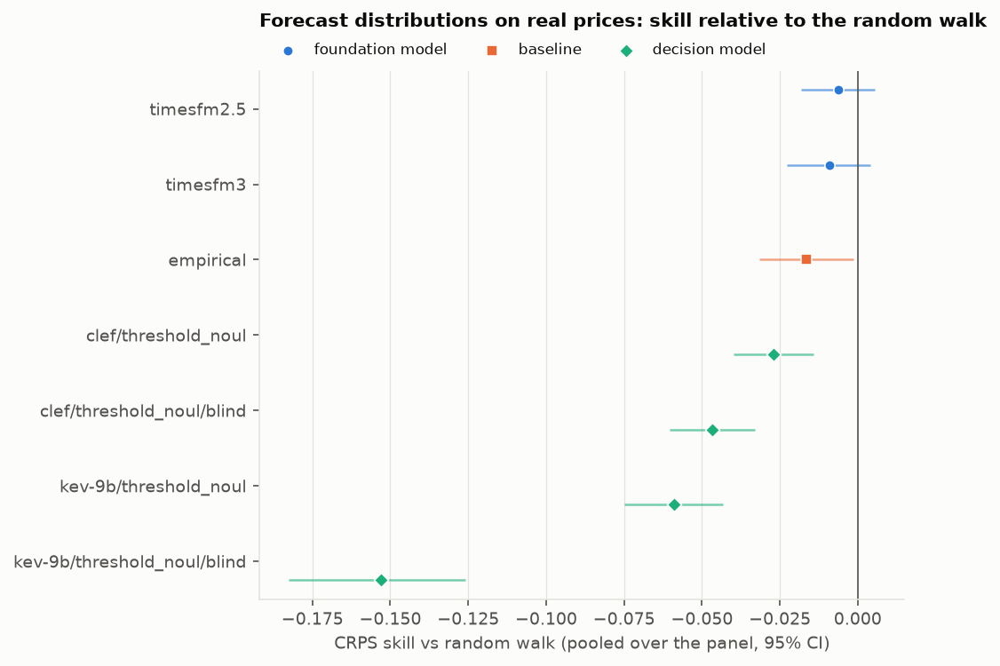
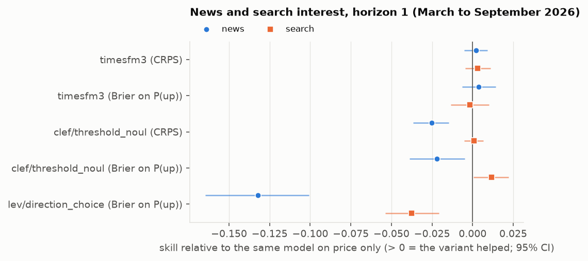
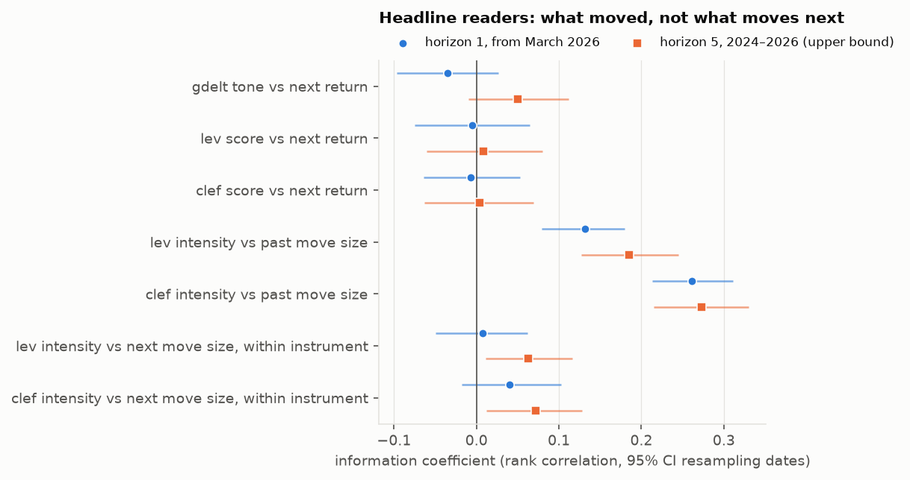
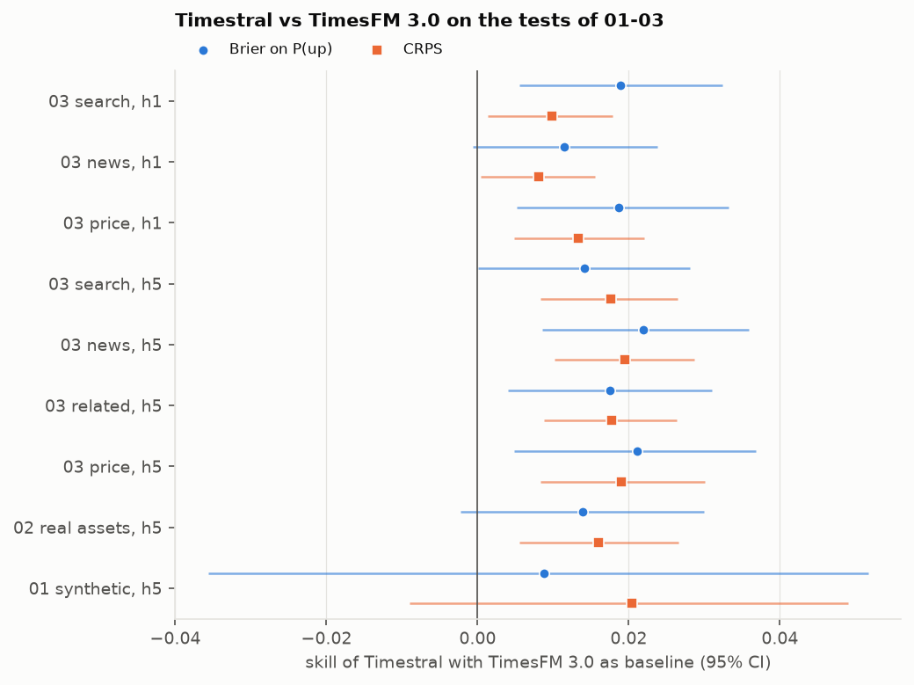

# signalbench

[](https://github.com/vale-dinap/signalbench/actions/workflows/ci.yml)

Benchmarking AI models as trading-signal sources: decision models, time-series foundation models and their combinations, scored on calibrated forecasts.

> Research in progress: notebooks 01 to 04 are complete, with an addendum (06) on a model released since; a forward test on live data is next.

## Bottom line

Language models and time-series foundation models are increasingly proposed as sources of trading signals. This project tests whether they are, with three safeguards that such claims often skip: each model sees only information available at the time of the forecast, results are compared before and after a model's release where it falls inside the test period (outcomes after the release cannot have been memorised), and every model is scored against a random walk with confidence intervals.

**At daily horizons (1 and 5 days) on eight liquid instruments, none of the models tested provides a usable signal of where prices go next.**

- **TimesFM 3.0** forecasts calibrated distributions that tie the random walk (CRPS skill −0.009, interval −0.023 to +0.004). That makes it usable as a risk input, such as interval or position sizing, but not as a source of returns.
- **Timestral** (Mistral, released after these tests were run) beats TimesFM 3.0 on every real-asset test and edges the random walk (CRPS skill +0.007, +0.001 to +0.014), through better-sized intervals rather than direction: its Brier skill on P(up) is −0.005 (−0.016 to +0.005). Those results are in-sample for it, so recall cannot be ruled out (06); the forward test checks both claims.
- **The decision models tested** are worse than the random walk as forecasters, and headlines make them worse. Combined with TimesFM they add nothing measurable (+0.003, −0.007 to +0.013).
- **As headline readers** the decision models do understand the news: their ratings track the move just made. But their news score has no information coefficient with the next return (−0.005, −0.075 to +0.064). Studies that find LLM sentiment predicting next-day returns (Lopez-Lira and Tang, 2023) locate the effect in small stocks and in news released after the close; with liquid instruments and news known before the decision time, none remains.

These results do not cover less-covered assets, intraday horizons, news timed to the minute, volatility forecasting (04 found a weak lead, not a result) or prediction markets. They are provisional until the [forward test](docs/forward_test_plan.md) scores the same models, frozen, on November 2026 to April 2027, which also includes an exploratory test on prediction markets.

## Models

All eleven decision models were screened on synthetic data (01); the best format of the strongest few went on to real prices. TimesFM 3.0 is the foundation model throughout, with 2.5 as the previous-generation reference; Timestral, released after the test period, is scored on the same tests in an addendum (06). The forward test uses clef, lev, kev-9b, TimesFM 3.0 and Timestral, frozen by file hash and revision.

| Model | Params | Base model | Build | Licence | Used in |
|---|---|---|---|---|---|
| [`julia-1`](https://huggingface.co/ggml-org/Julia-1-GGUF) | 0.1 B | mmBERT-small (ModernBERT family) | Q8_0 | Apache 2.0 | 01 |
| [`laya`](https://huggingface.co/ggml-org/Laya-GGUF) | 0.4 B | ModernBERT-large | Q8_0 | Apache 2.0 | 01, 03 |
| [`d1-omni-600m`](https://huggingface.co/LiquidAI/d1-omni-600M-GGUF) | 0.6 B | LFM2.5-Encoder-350M (Liquid AI) | Q8_0 | LFM Open License 1.0 | 01 |
| [`d1-3b`](https://huggingface.co/LiquidAI/d1-3B-GGUF) | 3 B | LFM2.5-VL-3B (Liquid AI) | Q4_K_M | LFM Open License 1.0 | 01 |
| [`kev-4b`](https://huggingface.co/ggml-org/Kev-4B-GGUF) | 4 B | Qwen3.5-4B-Base | Q4_K_M | Apache 2.0 | 01 |
| [`lev`](https://huggingface.co/ggml-org/lev-GGUF) | 4 B | Qwen3.5-4B | Q4_K_M | Apache 2.0 | 01–04, forward test |
| [`kev-9b`](https://huggingface.co/ggml-org/Kev-9B-GGUF) | 9 B | Qwen3.5-9B-Base | Q4_K_M | Apache 2.0 | 01–04, forward test |
| [`bespoke-nimble-9b-v3`](https://huggingface.co/ggml-org/Bespoke-Nimble-9B-v3-GGUF) | 9 B | Qwen3.5-9B | Q4_K_M | CC BY-NC 4.0 | 01 |
| [`cloudflare_clef-flash`](https://huggingface.co/bartowski/Cloudflare_clef-flash-GGUF) | 9 B | Qwen3.5-9B | Q4_K_M | Apache 2.0 | 01 |
| [`openjev`](https://huggingface.co/ggml-org/OpenJev-GGUF) | 27 B | Qwen3.8-27B | Q4_K_M | CC BY-NC 4.0 | 01, 02 |
| [`clef`](https://huggingface.co/ggml-org/Clef-GGUF) | 27 B | Qwen3.8-27B | Q4_K_M | Apache 2.0 | 01–04, forward test |
| [TimesFM 3.0](https://huggingface.co/google/timesfm-3.0-pytorch) | 0.3 B | time-series foundation model (Google) | F32 | TimesFM Non-Commercial 1.0 | 01–04, forward test |
| [TimesFM 2.5](https://huggingface.co/google/timesfm-2.5-200m-pytorch) | 0.2 B | time-series foundation model (Google), previous generation | F32 | Apache 2.0 | 01, 02 |
| [Timestral](https://huggingface.co/mistralai/Timestral-209M) | 0.2 B | time-series foundation model (Mistral), released 15 October 2026 | F32 | Modified MIT | 06 (addendum; released after the test period), forward test |

Every model runs locally; decision models as quantised GGUF builds. Decision models do not generate text: given a state and typed questions, each returns probabilities over the answer options in a single forward pass. Sources: the linked model cards and the llama.cpp [decision-models overview](https://huggingface.co/blog/ggml-org/decision-models-in-llamacpp). Three licences are non-commercial (bespoke-nimble-9b-v3, openjev and TimesFM 3.0): fine for research, but trading with them needs the owner's permission. Timestral's allows commercial use for companies below $20 M of monthly revenue.

## Findings so far

| Notebook | Question | Answer |
|---|---|---|
| [01 · Synthetic series](notebooks/01_synthetic_series.ipynb) | Can the models see structure that is really there? | TimesFM 3.0 recovers about 80% of the achievable skill (CRPS skill +0.110 against the oracle's +0.137). No decision model beats the random walk on full distributions; most expect trends to reverse. |
| [02 · Real assets](notebooks/02_real_assets.ipynb) | Does any of it carry over to real prices? | No predictor beats the random walk at a 5-day horizon on eight liquid instruments, 2024–2026. TimesFM ties it (−0.009, interval −0.023 to +0.004) and is well calibrated; every decision model is worse. |
| [03 · Enrichment](notebooks/03_enrichment.ipynb) | Does added information create skill? | No. Related assets, technical indicators, news and search interest leave TimesFM unchanged. Decision models gain from summaries (indicators, search ratios) by losing a bearish lean, and lose from raw headlines, which make them more confident without making them more right. |
| [04 · Combinations](notebooks/04_combinations.ipynb) | Can decision models add to TimesFM? | No. Pools and agreement gates with TimesFM stay within ±0.01 of it. As headline readers they rate news sensibly (their ratings track the move already made), but their news score has no information coefficient with the next return (−0.005, interval −0.075 to +0.064). |
| [06 · Timestral](notebooks/06_timestral.ipynb) | Does a newer foundation model, released after these tests, change the answer? | Not for direction. Timestral beats TimesFM 3.0 on all eight real-asset tests (CRPS +0.008 to +0.019) and is the first predictor here to edge the random walk (+0.007, +0.001 to +0.014), but through its intervals, not its direction, and in-sample for it. |

In more detail:

- **The test bed works.** On synthetic series with known distributions, an oracle wins and ties the random walk where nothing is predictable, so differences come from the predictors, not the scoring (01).
- **How a decision model is asked matters as much as which model.** The same model's Brier skill ranges from −0.48 to −0.01 across four ways of asking the same question, with no format best for all; formats are therefore fixed per model on synthetic data, before any real outcome is seen (01).
- **Real prices leave little to forecast at one and five days.** Prices showed neither momentum nor reversal; no direction forecast beat even a naive base rate of how often prices rose (02).
- **Names and dates help decision models, and recall of the test period does not explain it.** A blinded state (no name, no dates, prices rebased) is the conservative result; the named state's advantage is unchanged after the models' base release, where recall is impossible (02, 03).
- **News hurts decision models as forecasters.** At a 1-day horizon, headlines widen lev's P(up) from a standard deviation of 0.069 to 0.168 and cost it 0.132 in Brier skill against its own price-only answers, while its hit rate stays below 50%. Headlines describe moves already in the price at the decision time (03).
- **Diversity without skill does not combine into skill.** TimesFM's P(up) correlates at most 0.14 with any decision model's, yet the best pool, with its weight fitted out of sample, gains only +0.003 in CRPS skill over TimesFM (−0.007 to +0.013) (04).
- **Read as sentiment, news is already priced.** Asked only how good or bad each headline is, the models' ratings follow the size of the past move (IC up to +0.26) but not the direction of the next one; their link to the next move's size is mostly cross-asset volatility (04).
- **A better foundation model forecasts risk, not direction.** Timestral's edge over the random walk comes from interval width: its 80% band ranks the size of the coming move better (rank correlation 0.149 within instrument, against 0.116). Its edge over TimesFM 3.0 comes from the centre: its median stays near the last close (0.13% away, against 0.43%), so it loses less on directional bets. On synthetic series, where recall is impossible, its lead over TimesFM 3.0 is not significant (06).









## Approach

Every model is reduced to the same output: the probability that an instrument's value at a given horizon will be above each of a grid of thresholds around the current value. That makes very different models directly comparable:

- **Decision models** (Jev-style "System One" models served via llama.cpp `/v1/systemone`) answer yes/no probability questions, asked in one of several elicitation formats.
- **Time-series foundation models** (Google TimesFM 3.0, 2.5 as a reference, and Mistral Timestral in 06) produce quantile forecasts, which are mapped onto the same thresholds; related series, news and search interest enter as past-only covariates.
- **Baselines** (random walk, empirical distribution of past changes) set the bar to beat.

Forecasts are scored with normalised CRPS, Brier score on P(up), interval coverage and answer coherence, always relative to the random walk on the same decision points, with paired bootstrap confidence intervals.

**Look-ahead controls.** Every input is aligned on when it became known, not on its date label: each series carries its close time (Binance midnight UTC, US market close in New York, the ECB's 14:15 Frankfurt fixing), news files count from 15 minutes after their time stamp, a Google Trends day from the end of the next day, and Trends' per-request rescaling is removed by using ratios only. Because the decision models' training cutoffs are not published, recall is controlled separately: a blinded state, and comparisons before and after the models' base release.

## Data

| Source | Used for | Access |
|---|---|---|
| Binance | BTC, ETH daily closes | public API |
| Yahoo Finance | SPY, AAPL, GLD, USO (ETFs rather than futures, which jump at contract rolls) | `yfinance` |
| ECB reference rates | EUR/USD, USD/JPY at a fixed daily time | public API |
| GDELT Global Knowledge Graph | news coverage, tone and headlines | raw 15-minute files (`python -m sbench.news`) |
| Google Trends | daily search interest | `pytrends`, stitched from overlapping windows |

Snapshots of everything the notebooks use are committed under `data/snapshots/`, so results reproduce without network access. The raw news store (about 200 MB) is not committed; `python -m sbench.news 2023-12-01 2026-09-30 data/raw/gkg` rebuilds it.

## Layout

```
src/sbench/        package (`import sbench`): data loaders, context sources, state builders, predictors,
                   headline readers, backtest, combinations, scoring, plots
notebooks/         research notebooks (narrative, experiments, results)
data/              snapshots and model results (committed for reproducibility); raw downloads (not committed)
docs/figures/      charts shown in this README
tests/             pytest suite
outputs/           generated charts (not committed)
```

## Setup

```bash
python -m venv venv
venv/Scripts/activate        # Windows; source venv/bin/activate elsewhere
pip install -e ".[notebook,dev]"
pytest
```

Decision models need a local llama.cpp server (Ollama, LM Studio, etc.) exposing `/v1/systemone`.

TimesFM (3.0, plus 2.5 as the previous-generation reference) is optional. Install a CUDA build of PyTorch first if you have a GPU, then the extra; weights download from Hugging Face on first use:

```bash
pip install torch --index-url https://download.pytorch.org/whl/cu130   # GPU; skip for CPU-only
pip install -e ".[tsfm]"
pip install -e ".[timestral]"    # Mistral Timestral, for 06; installed from GitHub, CPU or GPU
```

Other optional extras: `yahoo` (yfinance) and `trends` (pytrends), only needed to rebuild snapshots.

## Next

- **Forward test:** scoring on November 2026 to April 2027, a period no model or hypothesis here can reflect, against hypotheses registered in advance, including the news effect, the Bollinger-band reversal noted in 02 and Timestral's edge found in 06, plus prediction markets: see the [pre-registered plan](docs/forward_test_plan.md).
